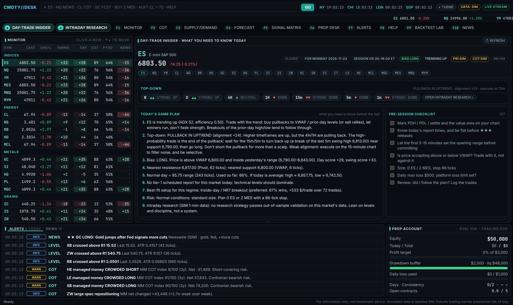
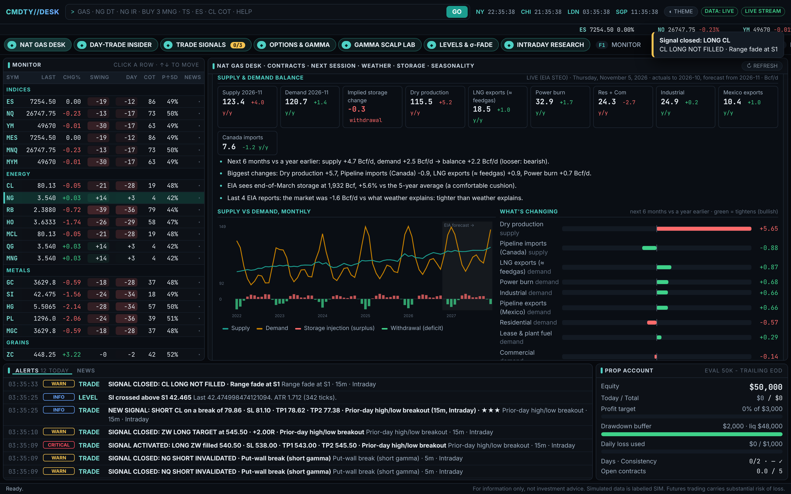
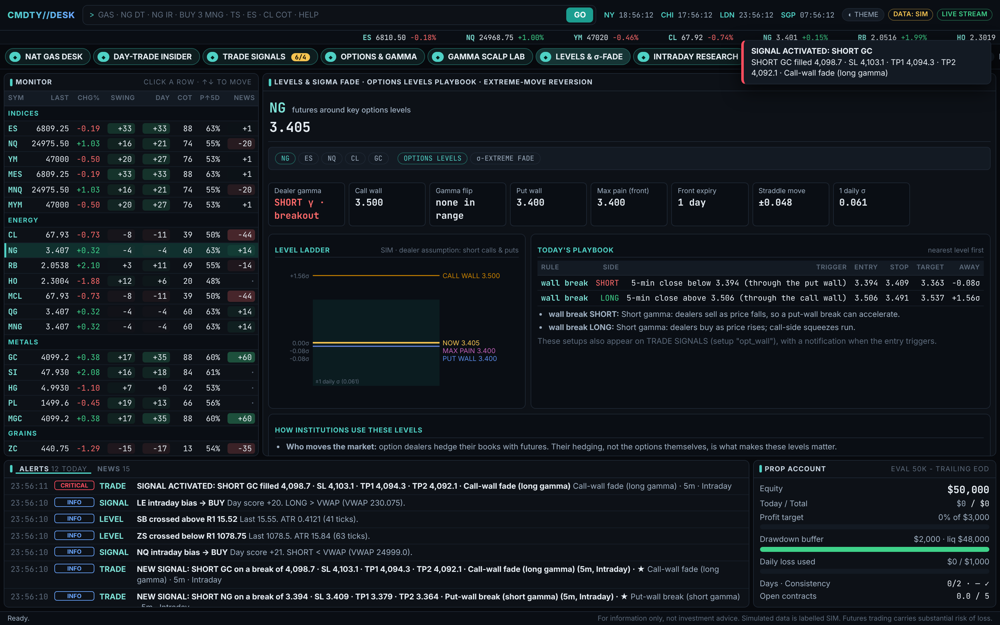
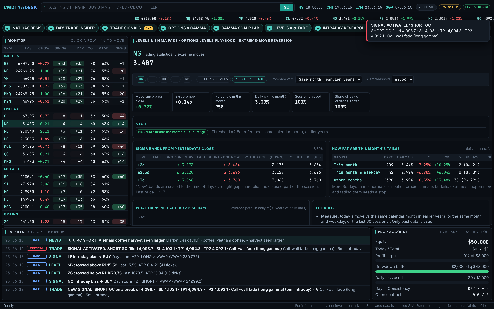
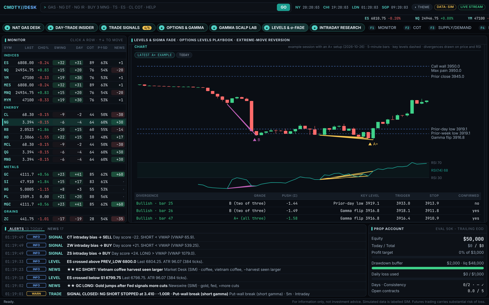
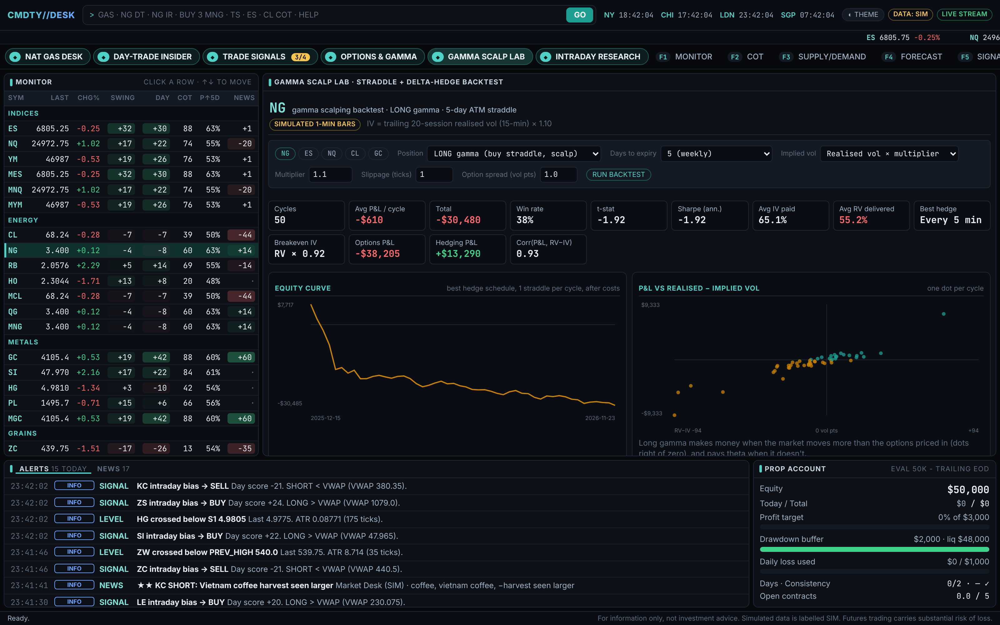

# CMDTY//DESK: Commodities Terminal for Prop Traders

A live, terminal-style dashboard for commodity and equity-index futures **day trading and swing trading**. It combines
quantitative signals (trend, breakout, mean reversion, carry, seasonality, volatility regime) with
quantamental ones (CFTC COT positioning, inventory supply/demand vs 5-year norms). It adds forecasts,
real-time alerts, and a **prop desk** that tracks evaluation/funded-account rules and blocks trades
that would breach them.

> Working name. Do a trademark search before you pick the commercial brand.



More screenshots in [`docs/screenshots/`](docs/screenshots): news, COT, signal matrix, prop desk, backtest lab,
optimiser, the classic theme and mobile.

**Themes:** *Nightfall* (default) is a graphite-navy design with a teal accent, sans-serif labels and monospaced
numbers. *Classic* is an amber-on-black terminal look. Switch between them with the ◐ THEME button.

## Quick start

```bash
pip install -r backend/requirements.txt
cp .env.example .env          # optional: DATA_MODE=live and an EIA key
./run.sh                      # open http://localhost:8000
```

Run the tests with `cd backend && python -m pytest -q`.

`DATA_MODE=sim` (the default) runs fully offline on deterministic simulated data, and every panel shows
**SIM** source badges. `DATA_MODE=live` pulls real data and falls back to sim **per source** if a feed fails:

| Data | Source | Key | Notes |
|---|---|---|---|
| COT positioning | CFTC Public Reporting API: Disaggregated (commodities), Traders in Financial Futures (indices) | none | weekly (Tue data, Fri release) |
| Inventories | EIA Open Data v2 (crude, gasoline, distillate, nat gas storage) | free | weekly |
| Prices | Yahoo Finance chart API | none | **prototype only**: delayed, not licensed for redistribution |

## Screens (F-keys or the command line)

| Key | Screen | What it shows |
|---|---|---|
| ◆ (`GAS`) | NAT GAS DESK | **MVP market.** Contract strip, expiry and roll; next-session expected range (weekday × expiry × holiday); weather (gas-weighted HDD forecast vs normal); EIA storage; seasonality from year × month down to weekday and expiry cycle; this month's paths in past years; weather vs price |
| ◆ (`OPT`) | OPTIONS & GAMMA | Open interest and volume by strike, expiries, put/call ratios, ATM IV, 25Δ skew, straddle-implied move, max pain, dealer gamma (GEX) profile, flip, call/put walls, hedge flow per 1% (NG, ES, NQ, CL, GC) |
| ◆ (`GS`) | GAMMA SCALP LAB | Backtest buying or selling ATM straddles and delta-hedging them with futures: hedge-frequency sweep, IV breakeven, P&L vs realised − implied vol, and day-trading results split by dealer gamma regime (NG, ES, NQ, CL, GC) |
| ◆ (`LX`) | LEVELS & σ-FADE | Futures playbook around call/put walls, gamma flip and max pain (wall fade, wall break, flip cross, expiry pin) with backtests; fade of ±2–3σ moves vs the same month's history, with confirmation, event study and intraday/swing backtests |
| ◆ (`TS`) | TRADE SIGNALS | Live trade signals with entry, stop loss, TP1/TP2, strategy, timeframe, confidence and evidence grade; lifecycle tracking, notifications and a track record |
| ◆ (`IR`) | INTRADAY RESEARCH | Top-down W→D→4H→1H→15m→5m→1m analysis; research-backed day-trade strategies with the optimal timeframe chosen in-sample and validated out-of-sample |
| ◆ (`DT`) | DAY-TRADE INSIDER | Landing page. Answers "what do I need to know today to day trade this market?": game plan, key levels, volume profile, regime, expected move, catalysts, ranked playbook, risk plan |
| F1 | MONITOR | Watchlist with swing/day composites, COT index and 5-day up-probability. Daily or 1-min candles with pivots, VWAP and a 20-day forecast cone |
| F2 | COT | Managed-money vs commercial net positions, COT index with crowded-long/short bands, cross-market table |
| F3 | SUPPLY/DEMAND | Stocks vs 5-yr same-week average, deviation σ, weekly surprise vs the normal change |
| F4 | FORECAST | 5d/20d targets, 1σ/2σ ranges, P(up), model components and the **walk-forward hit rate** |
| F5 | SIGNAL MATRIX | Every factor × every market as a heat map |
| F6 | PROP DESK | Rule editor and presets, drawdown/daily-loss/target meters, risk sizer, bracket order ticket, positions, trade log |
| F7 | ALERTS | Built-in triggers plus custom rules |
| F8 | HELP | Commands and methodology |
| F9 | BACKTEST LAB | Run, compare, optimise, walk-forward and Monte Carlo strategies, with a prop-evaluation simulator |
| F10 | NEWS | Market-linked headlines, each tagged LONG/SHORT per market with ★–★★★ importance; per-market news sentiment |

Command line examples: `CL`, `NG COT`, `GC FCST`, `BUY 2 MCL`, `SELL 1 CL`, `ALRT CL > 70`,
`ALRT NG SWING < -50`, `FLAT`, `BT`, `NQ NEWS`.

**Universe:** ES NQ YM (+ micros MES MNQ MYM) · CL NG RB HO · GC SI HG PL · ZC ZS ZW · KC SB CC CT · LE HE · MCL MGC (micros map to their parent's data).

## Signal methodology

Every factor is scored from −100 (bearish) to +100 (bullish).

* **Trend (TSMOM):** vol-normalised 20/60/120-day returns, blended through tanh.
* **Breakout:** position inside the 20-day Donchian channel.
* **Mean reversion:** 20-day z-score and RSI(14), faded.
* **Carry:** front vs second month, annualised. Backwardation is bullish. Needs a curve feed in live mode.
* **Seasonality:** average 20-day forward return for the same calendar window in prior years, weighted by hit rate.
* **COT:** managed-money 3-year index, read as contrarian at ≥90 / ≤10. The commercial index confirms.
  A weekly change ≥2σ is flagged.
* **Supply/demand:** stocks vs the 5-year same-week norm (z-score), plus the weekly surprise vs the normal change.
* **Swing composite:** trend 25%, COT 20%, S&D 20%, breakout 10%, carry 10%, seasonality 10%, mean reversion 5%.
  Weights are renormalised when a factor is unavailable.
* **Day composite:** VWAP deviation in ATRs 25%, trend 25%, breakout 20%, mean reversion 15%, news flow 15%.
  Floor pivots, previous high/low and ATR in ticks and $/contract support execution.
* **Forecast:** shrunk momentum drift + AR(1) + seasonal drift, with an EWMA volatility cone.
  The walk-forward 5-day hit rate is shown next to it. Expect roughly 50%. The value is in the range, not the direction.

## News feed (F10)

Every headline is mapped to the futures markets it moves. For each market it gets:
* **Signal:** LONG (bullish), SHORT (bearish) or NEUTRAL.
* **Importance:**
  * ★★★: tier-1 scheduled releases or shocks (Fed decisions, CPI, payrolls, OPEC+, EIA/USDA/WASDE reports,
    wars, sanctions, outages, export or import bans, hurricanes).
  * ★★: real fundamental news (inventories, export sales, crop conditions, Fed guidance, earnings of index heavyweights).
  * ★: commentary, previews, analyst opinion, or price-move stories.
* **Reasons:** hover a market tag to see the exact phrases that drove the call.

3★ headlines raise a CRITICAL alert and a toast, and 2★ headlines an INFO alert.

Each market also gets a **news sentiment** score: Σ direction × importance, halving every 12 h, scaled to −100…+100.
It appears in the monitor's NEWS column and the signal stack, and feeds the intraday composite at 15% weight.

| Setting | Options |
|---|---|
| Source | `DATA_MODE=sim`: simulated newswire (labelled SIM). `live`: Google News and Yahoo Finance RSS per market, plus any `NEWS_FEEDS`. |
| Classifier | `NEWS_CLASSIFIER=rules` (default): free, instant, explainable keyword model. `claude`: Claude reads batches of 20 headlines and returns schema-validated JSON, including second-order effects. If the call fails, it falls back to rules. Roughly a few cents per batch on the default model; `NEWS_LLM_MODEL` overrides it. |

RSS gives headlines and links only, with minutes of latency, and its terms usually forbid redistribution.
For a paid product, license a real-time newswire (e.g. Benzinga, Dow Jones, MT Newswires) and plug it in
next to `feeds.fetch_live`.

## Prop desk

`backend/app/prop/rules.py` models the rule families futures prop firms use:

* profit target, daily loss limit, minimum trading days
* max drawdown: **static**, **trailing intraday** or **trailing end-of-day**, with an optional lock at the starting balance
* contract caps (a micro counts as 1/10)
* consistency rule (best day ≤ X% of total profit)

Every order passes a **pre-trade check**: contract cap, plus whether the stop-out loss would breach the
drawdown buffer or the daily loss allowance. **Risk sizing** turns a stop in ticks and a "% of remaining
buffer" into contracts. Alerts fire at 75% of the daily loss used, within 25% of the drawdown, on a breach,
and when the target is hit but the consistency rule fails.

Brokers (`backend/app/prop/brokers.py`):

* `PaperBroker`: works out of the box, with OCO stop/target brackets.
* `TradovateAdapter` and `ProjectXAdapter`: REST skeletons written from the public API docs.
  **Not yet certified against live endpoints.** Test on demo credentials first.

Live routing stays disabled until `LIVE_TRADING_ENABLED=true`. Presets are generic templates. Users must
enter their own firm's current rules.

## Day-Trade Insider (default screen)

A pre-session briefing for each market, written the way a day trader prepares:

* **Game plan:** 6-7 plain-language bullets covering:
  * the regime and how to trade it;
  * the bias versus VWAP and yesterday's range;
  * the nearest resistance and support (in ticks);
  * the size of a normal day and how much is already used;
  * today's catalysts, the best-fit setup, and position size.
* **Pre-session checklist:** saved per day and market.
* **Key-level ladder:**
  * prior-day high/low/settle, today's open/high/low, VWAP and floor pivots;
  * prior 5-day and 20-day extremes, round numbers;
  * volume POC and value area.

  Each level shows its distance in ticks and ATR, with the live price marked.
* **Volume profile:** a composite of 20 sessions with POC, value area (70%), high-volume nodes ("magnets")
  and low-volume nodes ("fast moves"), plus where price sits relative to value. It is estimated from daily
  bars; a tick feed gives the true profile.
* **Regime:** ADX, efficiency ratio and Choppiness Index classify the market as TRENDING, RANGE-BOUND or
  TRANSITION, with what tends to work in each.
* **Expected move:**
  * 20-day average daily range, typical (p50) and big (p80) days;
  * the share of a normal range already used, and the projected high and low if today is an average day.
* **Seasonality:** weekday and month behaviour, the next 20 days in prior years, model P(up), COT state.
* **Catalysts:** the scheduled reports for this market and day (times ET; estimated dates are flagged),
  U.S. exchange holidays and early closes, and ★★+ news from the last 36 h.
* **Playbook, ranked for today's regime:** six single-session setups, each with today's exact trigger, stop
  and target prices, and an ACTIVE / NOT TODAY flag:
  * prior-day high/low breakout, gap-and-go, trend open-drive;
  * gap fade, pivot S1/R1 fade, inside-day/NR7 breakout.

  Each is backtested on ~3 years for this market, after costs, split by the regime known before each
  session. The verdict (PREFERRED / WORKS / MARGINAL / AVOID) requires both profit factor and t-stat.
  When nothing has an edge, the plan says so: sitting out is a valid call.
* **Risk plan:**
  * a size multiplier (cut for high volatility, ★★★ event days and unclear regimes);
  * a stop of about 25% of the average daily range with a 2R target;
  * risk per trade of 25% of the remaining daily-loss allowance, in full-size and micro contracts;
  * a daily stop, max trades, the consistency-rule profit cap, event and time-of-day rules.

  "Load plan into order ticket" pre-fills the prop desk.

The day-trade setups are tested on daily bars with the standard OHLC path model (up days trade
open→low→high→close, down days open→high→low→close). This is an approximation, so verify a setup on intraday
data before risking money on it.

## Nat Gas Desk (`GAS`): the MVP market

Natural gas is the primary market. The terminal opens on this desk, and NG is the default symbol everywhere.
Micro (MNG, 1,000 MMBtu, $1/tick) and E-mini (QG, 2,500 MMBtu, $12.50/tick) are used for prop-sized risk.

* **Contracts & roll.** NYMEX rule: trading ends 3 business days before the delivery month, with U.S. holidays
  skipped. Example: NGZ26 last trades Wed Nov 25, 2026, because of Thanksgiving. The desk also shows options
  (LNE) and micro expiry, a 6-month strip, and a "trade the next contract" warning in the expiry window.
* **Next-session outlook.** Expected range = recent 20-day realised range × weekday factor (for this month, shrunk
  toward the all-month factor) × expiry-cycle factor × holiday factor. It is shown in %, in $ per NG/QG/MNG, in
  ticks, and as the 80th-percentile "big day". Plain-language notes cover:
  * the roll and expiry;
  * options expiry;
  * EIA Thursday (and holiday-week changes);
  * Monday weather repricing;
  * days next to holidays;
  * the seasonal context.
* **Seasonality from macro to micro:**
  * year × month returns;
  * a month profile with the front contract, average and % up, annualised vol, and average range in % / $ / ticks;
  * this month's path in each past year vs the average and this year;
  * average range by weekday × month;
  * range by sessions-to-expiry;
  * day before / after holidays.

  Every historical day is labelled with its front contract, and roll-gap days are excluded from returns.
* **Weather.** Heating degree days, weighted by gas demand across 12 cities, plus a 14-day forecast vs the 10-year
  normal, with a bias in the heating season. A table shows each past year's HDD anomaly for this month vs the
  move. Live data comes from Open-Meteo (archive + forecast). **Confirm Open-Meteo's commercial terms before
  selling.** Past years use observed weather; archived *forecasts* need a vendor or Open-Meteo's
  historical-forecast APIs.
* **Storage.** EIA weekly working gas vs the 5-year average, plus the latest change vs normal.

The simulator reproduces NG's structural volatility patterns (winter, Thursday, Monday, pre-expiry) but no
directional edge. Its weather-to-price link is illustrative and labelled SIM. With `DATA_MODE=live`, the
analysis runs on about 10 years of the continuous NG=F series. For contract-by-contract studies (for example,
December contracts only), load per-contract history from a vendor.

### Winter dynamics (on the Nat Gas Desk)

* **Weather → price sensitivity:** % move per +10 HDD in the 14-day forecast, for winter vs the rest of the year,
  and for colder vs warmer revisions (the asymmetry). The desk saves a forecast snapshot every day; after about
  60 days it switches from the proxy (realised weather) to real forecast revisions.
* **Today's revision:** HDD added or removed since the previous run, and the implied move in % and $ per NG/MNG.
* **Tails by month:** the 95th-percentile up day vs the 5th-percentile down day, skew, and the 90th-percentile
  adverse move against a 5-day short vs a 5-day long.
* **Winter long-bias policy** (Nov–Mar; `NG_WINTER_POLICY=off` to disable):
  * NG swing shorts are blocked.
  * Intraday shorts lose a confidence star and get half size.
  * Longs gain a star on colder forecasts.
  * A **Cold forecast revision (winter long)** signal fires when 10 or more HDD are added.
  * The Insider leads with the policy.

## Options & gamma (`OPT`)

Black-76 greeks per option are aggregated into:
* dealer gamma exposure in $ per 1% move, and its profile across prices;
* the gamma flip, call and put walls, and max pain per expiry;
* put/call ratios (OI and volume), ATM IV, 25-delta risk reversal (the skew) and the straddle-implied move;
* the estimated futures hedging flow per 1% move.

Who is short the options is an **assumption**, and the screen lets you switch it:
* **standard:** dealers long calls / short puts, the equity convention;
* **short_calls:** customers buy calls, the default for NG in winter.

Options levels also feed the Insider's level ladder and game plan.

**Data:**
* `backend/data/options/{SYMBOL}_chain.csv` with columns expiry, strike, type, open_interest, volume, iv
  (underlying optional). Export it from CME QuikStrike, Databento, a broker, or a licensed Barchart API.
  Scraping Barchart's website is against its terms.
* ES/NQ in live mode: CBOE's free delayed SPX/NDX chains, scaled to the futures.
* Otherwise a labelled simulated chain with the right skew sign: NG winter call skew, index put skew.

## Live data for natural gas (`DATA_MODE=live`)

Set `DATA_MODE=live` in `.env` and restart. No API keys are needed for NG.

| Data | Source | Notes |
|---|---|---|
| Daily prices, 10 years | Yahoo `NG=F` | ~10-min delayed. **Back-adjusted at every contract roll**, so the roll gap isn't counted as a move. Charts still show actual traded prices |
| Live price and session bars | Yahoo 1-minute, polled every 30 s in a background thread | `LIVE_FOCUS=NG` (other markets: last price every 2 min) |
| Intraday history | Yahoo 1-minute (last 30 days) + 5-minute (last 60 days) | Saved to `backend/.cache/intraday/`. It **grows every day the terminal runs**. For years of history, import a CSV |
| Futures curve | Yahoo per-contract (`NGF27.NYM`, …), 18 months | M1–M2, winter/summer strips, winter premium, H/J |
| Supply & demand balance | EIA Short-Term Energy Outlook (`www.eia.gov`, keyless) | See below |
| Storage | EIA weekly report + full history by region (`ir.eia.gov`) | Latest report with regions, vs year ago and vs 5-year |
| Weather | Open-Meteo archive + 16-day forecast, 12 gas-weighted cities | A forecast snapshot is saved daily; real revision sensitivity kicks in after ~60 days |
| COT | CFTC disaggregated | Weekly |
| News | Google News + Yahoo Finance RSS | |
| Options | **No free source** | Shown simulated and labelled. In live mode, synthetic option levels are excluded from trade signals, the level ladder and the vol-divergence levels. Load a real chain CSV to use them |

**DATA SOURCES panel.** The Nat Gas Desk opens with this panel. It shows every feed, its status (LIVE, SIM or ERROR) and how fresh it is.

**Before selling the product.** Yahoo data is unofficial and not licensed for redistribution. Swap in a licensed CME feed (e.g. Databento) first, and check Open-Meteo's commercial terms.

### Supply & demand balance (Nat Gas Desk)


All in Bcf/d.

**Monthly balance (EIA STEO, history + forecast).**
* Supply: dry production (and marketed production by basin), Canada pipeline imports.
* Demand:
  * LNG exports (≈ feedgas), Mexico pipeline exports;
  * power burn, residential, commercial, industrial;
  * lease & plant fuel and pipeline fuel.
* The implied storage change, and EIA's end-of-March storage forecast vs the 5-year average.

**What's changing.** The year-on-year change of each component over the next 6 months, colored by
whether it tightens (bullish) or loosens (bearish) the balance.

**Weekly weather-adjusted balance.**
* The EIA weekly storage change is compared with what that week's gas-weighted heating and cooling
  degree days normally produce (fitted on the past 3 years).
* Persistent negative bars = the market is tighter than weather explains (LNG, power or exports
  pulling harder, or production slipping).

**Not available free.** Daily pipeline flows (LNG feedgas by terminal, daily production) need a paid
vendor (Wood Mackenzie, LSEG, Criterion).

## Levels & σ-fade (`LX`)



### Trading futures around key options levels
Option dealers hedge with futures, and that hedging is what makes the levels matter:
* **Long gamma** (positive GEX, above the flip): dealers sell rallies and buy dips, so ranges hold.
  Call wall = resistance, put wall = support.
* **Short gamma** (below the flip): dealers chase moves, so a wall break can accelerate.

The rules tested, one trade per rule per session, flat by the close:

| Rule | When | Trade |
|---|---|---|
| Wall fade | long gamma | Tag the wall, then a 5-min close back inside → fade it. Stop beyond the day's extreme, target 1.5R |
| Wall break | short gamma | 5-min close through the wall → go with it. Stop back inside, target 2R |
| Flip cross | any | 5-min close through the gamma flip → trade the new regime. Target 2R |
| Expiry pin | last 2 sessions to front expiry | From mid-session, trade toward max pain |

* The screen shows today's levels on a ladder and the concrete orders (trigger, entry, stop, target).
* The same setups appear on Trade Signals as `opt_wall`, with notifications.
* For a real backtest, save `backend/data/options/{SYMBOL}_levels.csv` (date, call_wall, put_wall,
  flip, max_pain, gex). Each row is used for the next session.
* Without that file, levels come from a synthetic chain rebuilt each morning (labelled SIM).

### σ-extreme fade (mean reversion with confirmation)


**Measuring the move.** Today's move is measured against the history of the same calendar month in
earlier years. Alternatives: the same month and weekday, or the last 60 sessions. Only past data is used.

**Intraday scaling.** Intraday, the move since yesterday's close is scaled by how much of a day's
variance normally happens by that time (overnight gap share plus the elapsed part of the session).

**The trade:**
* **Arm** at ±2/2.5/3σ.
* **Confirm:** a 5-min bar closes beyond the previous bar's high (long) or low (short). Swing:
  a 0.5σ bounce off the extreme within 3 days.
* **Stop** beyond the day's extreme.
* **Target** halfway back to yesterday's close.

**What the screen shows:**
* σ bands for now and for the close.
* How fat this month's tails are (count of 3σ days vs a normal distribution).
* An event study of the average path after ±kσ days.
* In-sample / out-of-sample grids for intraday and swing, with and without confirmation, split
  into fading drops and fading rallies.

Live: the `sigma_fade` setup on Trade Signals.

**NG in winter.** Fading rallies means shorting into weather risk. The winter policy applies:
shorts are intraday-only at half size.

API: `GET /api/strategy/optlevels/{symbol}`, `GET /api/strategy/sigma/{symbol}?ref=month&k=2.5`.

### Vol push + key level + RSI divergence


A reversal setup with three filters and a trigger. Long side shown; shorts mirror it.

1. **Volatility.** The fastest 30-minute leg in the last 2½ hours moved at least 1.5σ for that
   length of time. σ comes from the same month in earlier years.
2. **Key level.** The new low is within 0.25 daily σ of one of these levels:
   * prior-day high, low or close, or prior-week high or low;
   * for options markets, the put wall, call wall, gamma flip or max pain.
3. **RSI divergence (5-min bars, RSI 14).** Price makes a lower low than an earlier swing low, but
   RSI makes a higher low. RSI must have been below 40 at the first low.

**Trigger.** Within 3 bars, a 5-minute close above the divergence bar's high.

**Risk.**
* Stop 0.1σ beyond the extreme.
* Target 2R, or VWAP if it is nearer but at least 1R away.
* Flat by the close.

**What the screen shows:**
* Candles with the key levels, and the RSI panel with each divergence drawn and graded:
  * **A+**: all three filters;
  * **B**: two of three;
  * **C**: divergence only.
* The latest A+ example session.
* An ablation table showing what each filter adds.
* 32 configurations (5- vs 15-minute bars, volatility definition and strength, level on/off,
  divergence on/off) with in-sample / out-of-sample results.

Live: the `vol_div` setup on Trade Signals.

API: `GET /api/strategy/voldiv/{symbol}`.

## Gamma scalp lab (`GS`)



Each cycle buys (long gamma) or sells (short gamma) one at-the-money straddle at the regular-session
open, priced with Black-76, holds it 1–20 sessions to expiry, and hedges its delta with futures
on 1-minute bars. P&L ≈ ½·Γ·F²·(σ²realised − σ²implied)·t, minus costs.

* **Hedge-frequency sweep:** every 5 min, 15 min, hourly, once at the close, or on a ±0.25 delta band.
  Each hedge pays slippage plus commission; the option pays half its bid/ask (in vol points) on entry.
* **IV sweep and breakeven:** options priced at realised vol × 0.8 … 1.3. The screen finds the
  multiplier where the trade stops paying, so you can compare it with today's ATM IV on `OPT`.
* **Scatter of P&L vs realised − implied vol:** one dot per cycle.
* **Day trading by gamma regime:** ORB, intraday momentum, noise-area and RSI(2) results, split by
  positive vs negative dealer gamma on the prior day.

**The IV is an assumption.** There is no free history of futures-option implied vol, so by default
the IV is the trailing 20-session realised vol (15-minute returns) × a multiplier, using only past
data. For real conclusions, supply your own data:
* `backend/data/options/{SYMBOL}_iv.csv` with columns date, iv (decimal or %), then pick "From CSV";
* `backend/data/options/{SYMBOL}_gex.csv` with columns date, gex for the regime split.

Sources: CME QuikStrike, Databento, or a broker. Results on simulated bars only show how the method works.

API: `GET /api/backtest/gammascalp?symbol=NG&dte=5&side=1&iv_mode=rv_mult&iv_value=1.1&slip_ticks=1&opt_spread_vol=0.01`
and `GET /api/backtest/gamma-regime?symbol=ES`.

## Trade signals (`TS`)

Every 15 seconds the engine scans all markets and turns the analytics into concrete trade plans:

| Setup | Style · timeframe | When | Evidence |
|---|---|---|---|
| Prior-day high/low breakout | Breakout · 15m | trending regime, yesterday's extreme untouched | C |
| VWAP pullback in trend | Trend · 5m | trend plus intraday score agree, price extended from VWAP | C |
| Range fade at S1 / R1 | Reversion · 15m | range-bound regime | C |
| Opening range breakout (OCO) | Breakout · 15m | after the first 15 minutes, range 0.05–0.6 ADR | B |
| Intraday momentum into the close | Momentum · 30m | last 30 minutes of the regular session | A |
| Swing trend + fundamentals | Swing · daily | STRONG swing composite, COT not crowded the same way | A |
| News catalyst | Event · 5m | fresh ★★★ headline agreeing with the tape | B |

**What each signal includes:**
* direction, entry type (stop / limit / market) and entry price;
* stop loss, TP1 and TP2, with reward:risk;
* risk per contract and size from the prop account's risk budget (full and micro), plus a warning when the
  stop is too wide for the account;
* confidence of 1–3 stars, from how many independent confirmations agree: intraday composite, regime, news;
* the evidence grade and the reasons behind the signal.

**Lifecycle.** PENDING → ACTIVE (entry traded) → TP1 (half off, stop to breakeven) → TARGET / STOPPED /
BREAKEVEN / TIME, or INVALIDATED / EXPIRED / OCO if it never fills. A gap through the stop counts as a full −1R.
Results are scored in R. The **track record** is a forward record by setup, it persists across restarts, and
it is never edited.

**Notifications.**
* **In the app:** toast, sound and the alert feed.
* **Desktop:** browser notifications.
* **Phone:** set `DISCORD_WEBHOOK_URL`, or `TELEGRAM_BOT_TOKEN` + `TELEGRAM_CHAT_ID`, or `SIGNAL_WEBHOOK_URL`
  in `.env`. `NOTIFY_EVENTS` picks which events are pushed.

**Paper trade** places the signal on the paper account as a bracket order (stop + TP2), after the prop-rule checks.
Signals are rule-generated ideas, not advice. Most intraday setups are grade C.

## Intraday research (`IR`)

**Top-down analysis.** Each timeframe has a job:
* **Weekly and daily:** set the bias.
* **4H and 1H:** show the swing (trend leg or pullback).
* **15m, 5m and 1m:** time the entry.

Per timeframe the screen shows the EMA20/50 trend and slope, swing structure (HH/HL vs LH/LL), RSI, ATR and its
percentile, position in the range, the nearest swing high and low, and a sparkline. These roll up into an
alignment score (−100…+100), a setup label (ALIGNED UP/DOWN, PULLBACK IN UPTREND, RALLY IN DOWNTREND, MIXED…),
a plan, and the timeframe to execute on.

**Research-backed strategies.** Each one is tested over its own "timeframe" dimension:

| Strategy | Evidence | Timeframe tested | Sources |
|---|---|---|---|
| Market intraday momentum (last half-hour) | A | trade window 15/30/60m | [Gao, Han, Li & Zhou, JFE 2018](https://econpapers.repec.org/RePEc:eee:jfinec:v:129:y:2018:i:2:p:394-414); [Baltussen, Da, Lammers & Martens, JFE 2021](https://ideas.repec.org/a/eee/jfinec/v142y2021i1p377-403.html) (60+ futures) |
| Opening range breakout | B | OR length 5/15/30/60m | [Holmberg, Lönnbark & Lundström, FRL 2013](https://ideas.repec.org/a/eee/finlet/v10y2013i1p27-33.html) (crude oil); [Zarattini, Barbon & Aziz](https://papers.ssrn.com/abstract=4416622); [replication: ≈0 net of costs](https://www.mql5.com/en/blogs/post/776235) |
| Noise-area intraday momentum | B | decision interval 15/30/60m | [Zarattini, Aziz & Barbon 2024](https://ideas.repec.org/p/chf/rpseri/rp2497.html) |
| EIA-day half-hour momentum (CL/RB/HO) | B | trade window 15/30m | [Wen, Indriawan, Lien & Xu, Energy Journal 2023](https://econpapers.repec.org/RePEc:aen:journl:ej44-5-xu) |
| Pre-FOMC drift (ES/NQ/YM) | B | exit time | [Lucca & Moench, JF 2015](https://www.newyorkfed.org/medialibrary/media/research/staff_reports/sr512.html); [faded after 2015](https://ideas.repec.org/a/eee/finlet/v40y2021ics1544612320315956.html) |
| VWAP trend | C | bar size 1/5/15m | [Zarattini & Aziz 2023](https://concretumgroup.com/volume-weighted-average-price-vwap-the-holy-grail-for-day-trading-systems/); [disputed in replications](https://www.quantconnect.com/forum/discussion/16706/bear-bull-traders-039-paper-on-quot-the-holy-grail-quot-not-so-fast/) |
| RSI(2) reversion (control) | C | bar size 1/5/15m | no peer-reviewed support: shows how often luck looks good |

**Validation.**
* Each test trades 1 contract and pays commission plus slippage on both sides.
* Timeframe and parameters are chosen on the first 60% of sessions; the result that counts is on the last 40%.
* A rolling walk-forward re-optimises on 120 sessions and trades the next 25.
* EDGE requires an out-of-sample t-stat above a multiple-testing-corrected threshold (≈2.6), at least 30 trades,
  and walk-forward t ≥ 2.
* Every strategy reports its gross ticks per trade against the round-turn cost.

The test suite includes a **positive control**: an intraday-momentum effect is planted in the data, and the engine
must detect it, choose the 30-minute window and rank it first. It does.

**Data.** Drop real 1-minute bars into `backend/data/intraday/{SYMBOL}_1m.csv`, with columns timestamp, open,
high, low, close, volume (ET or UTC). Sources include Databento, FirstRate Data, Kibot or a platform export.
Without real data, a synthetic 1-minute simulator runs instead. It is consistent with the daily bars and the
time-of-day volatility profile, but it contains **no edge by construction**, so it serves as a null benchmark.
Only real data can show real edges.

## Backtest lab (F9)

**Strategies.** Each strategy declares its parameters, so the UI builds the input form and the
optimisation grid automatically. Every strategy can be set to long/short, long-only or short-only.

| Family | Strategies |
|---|---|
| Trend | MA crossover · Donchian breakout (turtle) · Time-series momentum |
| Mean reversion | RSI reversion · Bollinger band reversion |
| Quantamental | COT contrarian · Trend + COT crowding filter · Inventory supply/demand (energy) |

**Execution model.**
* A signal at a bar's close is filled at the **next bar's open**, so there is no look-ahead.
* Commission and slippage (in ticks) are charged per contract per side.
* Optional ATR stop-loss and take-profit. A gap through a level fills at the open, and there is no
  instant re-entry after a stop.
* Sizing is fixed contracts, or risk-based (account × risk% ÷ (ATR × $/pt)) with a cap.
* COT data is usable from its Friday release. EIA data is usable from the Wednesday after the week it covers.

**Tools.**
* **Run:** equity vs buy & hold, drawdown, full metrics (Sharpe, Sortino, Calmar, profit factor, win
  rate, exposure…), trade list, monthly P&L heatmap.
* **Prop evaluation simulator:** starts a new evaluation every 5 days and replays the strategy through
  the chosen firm rules. Reports pass %, the fail split (drawdown vs daily loss), timeouts and median
  days to pass.
* **Compare:** overlays up to 3 earlier runs.
* **Optimise:** grid search of up to 600 combinations over any parameters, with an out-of-sample holdout.
  It shows the top results, a 2-D heatmap, and overfitting diagnostics: in-sample/out-of-sample rank
  correlation, share of profitable combinations, and the best combination's out-of-sample/in-sample ratio.
  Click a row to load and run it.
* **Walk-forward:** rolling or anchored. Re-optimises on each training window and trades the winner on
  the next unseen window. Reports the stitched out-of-sample equity, WF efficiency and parameter stability.
* **Monte Carlo:** resamples the trade sequence to give final P&L and max-drawdown percentiles, plus
  the probability of breaching the prop account's max drawdown.

To add a strategy, write a single function plus one `Strategy(...)` entry in `backend/app/backtest/strategies.py`.
The UI picks it up automatically.

## API

REST: `/api/watchlist`, `/api/snapshot/{sym}`, `/api/history/{sym}`, `/api/intraday/{sym}`, `/api/cot[/{sym}]`,
`/api/supply-demand`, `/api/matrix`, `/api/alerts[/rules]`, `/api/prop[/presets|/rules|/reset|/size|/flatten]`,
`/api/orders`, `/api/backtest/{strategies|run|optimize|walkforward|montecarlo}`, `/api/news[/scores|/status]`, `/api/insider/{sym}`, `/api/intraday/{research|topdown}/{sym}`, `/api/tsignals[/stats|/{id}/dismiss|/{id}/paper|/test-notify]`, `/api/natgas/{outlook|seasonality|weather|contracts|dynamics}`, `/api/options/{sym}?mode=`.

WebSocket: `/ws` streams `tick`, `signals`, `alert`, `fill`, `news` and `tsignal` messages. Interactive docs are at `/docs`.

## Layout

```
backend/app/
  config.py, universe.py        settings, contract specs (tick size/value, CFTC codes, EIA series)
  data/sim.py, live.py, store.py simulator, CFTC/EIA/Yahoo adapters, in-memory market hub
  signals/quant.py, fundamental.py, forecast.py, engine.py
  news/feeds.py, classifier.py, llm.py, service.py  RSS + sim feeds, rule & Claude classifiers, scoring
  daytrade/calendar.py, analytics.py, playbook.py, insider.py  report calendar, regime/profile/ranges, setups, briefing
  data/intraday.py; intraday/strategies.py, research.py, topdown.py  1-min data (CSV or sim), research strategies, validation, top-down
  tradesignals/setups.py, manager.py, notify.py  trade-signal detectors, lifecycle + track record, Discord/Telegram/webhook
  natgas/contracts.py, seasonality.py, weather.py, dynamics.py  NG calendar, seasonality + outlook, HDD weather, winter dynamics/policy
  options/chains.py, analytics.py  option chains (CSV / CBOE / sim), Black-76 greeks, GEX, skew, walls, max pain
  alerts.py                     built-in + user rules, dedup/cooldown
  backtest/strategies.py, engine.py  strategy library; simulator, metrics, optimiser, walk-forward, Monte Carlo
  prop/rules.py, brokers.py     prop rule engine, paper/Tradovate/ProjectX adapters
  main.py                       FastAPI REST + WebSocket, background tick & signal loops
backend/tests/                  signals, prop rules, brackets, alerts, API end-to-end
frontend/                       vanilla JS terminal UI + vendored TradingView Lightweight Charts (Apache-2.0)
```

## Before you sell this: commercial checklist

1. **Licensed market data.** Real-time CME/ICE prices need exchange licences, and redistributing them to
   paying users needs a vendor agreement that covers display/redistribution (e.g. Databento, dxFeed,
   Barchart, or Rithmic/CQG via the user's own login). Yahoo data must not be resold. CFTC and EIA data are public.
2. **Regulation.** Selling trading signals or "alerts" to US customers can touch CTA registration with
   CFTC/NFA. The publisher exclusion depends on the advice being impersonal and not tailored. Get a
   securities/derivatives lawyer before launch. Keep the "not investment advice" disclaimers.
3. **Prop firm integration.** Most firms provision accounts on Tradovate, Rithmic, ProjectX-based
   platforms, NinjaTrader or CQG. Third-party apps often need vendor approval or conformance testing
   (Rithmic especially). Firm rules change often, so ship rule presets you can update without a release.
4. **Honest performance claims.** Show out-of-sample hit rates (as the forecast screen does), never
   cherry-picked backtests.

## Roadmap

* Licensed real-time futures feed with a full curve, so carry and calendar spreads work in live mode
* USDA WASDE / Crop Progress, LME/COMEX warehouse stocks: S&D for metals, grains and softs
* Economic and report calendar (EIA, WASDE, COT, FOMC) with news-blackout rules for prop accounts
* Users, auth, subscriptions (Stripe), per-user alert delivery (email, Telegram, Discord, push)
* Persistent storage (Postgres/Timescale), saved backtests and shareable strategy reports
* Portfolio backtests (one strategy across many markets), intraday-bar backtests, custom strategy builder
* Multi-account prop dashboard (copy-trading across evaluations), payout tracker
